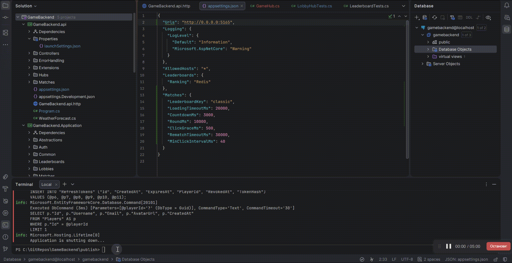

[](https://github.com/AriYeSiX/GameBackend/actions/workflows/ci.yml)
# GameBackend

Бэкенд для мультиплеерной мини-игры: ASP.NET Core 10, PostgreSQL, Redis, SignalR. Клиент — Unity (`ClickerClient/`).

## Игровой цикл

1. Игроки входят (JWT + refresh-токены с ротацией), создают лобби или заходят в открытое.
2. Когда все в лобби нажали «Готов», сервер создаёт матч и рассылает `MatchStarting`.
3. Клиенты загружают сцену и сообщают `MatchLoaded`. Когда загрузились все (или истёк таймаут загрузки),
   сервер рассылает `MatchStarted`: 3 секунды отсчёта и 10 секунд раунда.
4. Каждый клик отправляется на сервер. Счёт считает сервер: `HINCRBY` в Redis без блокировок,
   ограничение частоты через `SET NX PX`, клики вне раунда игнорируются.
5. Фоновый сервис `MatchDeadlineWorker` по очереди дедлайнов (Redis Sorted Set) завершает раунд,
   записывает результаты в лидерборд и рассылает `MatchFinished`.
6. Реванш начинается, когда его запросили все оставшиеся игроки.

Состояние лобби и матчей хранится в Redis, поэтому несколько экземпляров API могут обслуживать одних и тех же игроков
(для рассылки событий между экземплярами нужен Redis backplane SignalR).

## Запись геймплея



## Запуск

### Требования

- [Docker Desktop](https://www.docker.com/products/docker-desktop/)
- для разработки и тестов: .NET 10 SDK
- для клиента: Unity 6 (6000.0)

### Сервер одной командой

```bash
docker compose up -d --build
```

Поднимаются PostgreSQL, Redis и API. Миграции базы применяются автоматически при старте API.

Проверка: `http://localhost:5165/health` должен вернуть `Healthy`.

Пароль базы и секрет JWT берутся из переменных окружения `POSTGRES_PASSWORD` и `JWT_SECRET`
(можно положить их в файл `.env` рядом с `docker-compose.yml`). Без них используются значения
для локального запуска; при развёртывании где-либо, кроме своего компьютера, задайте свой `JWT_SECRET`.

Остановить: `docker compose down` (данные базы сохраняются в volume `pgdata`; `docker compose down -v` удалит и их).

### Разработка

Базы — в Docker, API — из IDE (профиль `http` в `launchSettings.json`):

```bash
docker compose up -d postgres redis
dotnet ef database update --project GameBackend.Infrastructure --startup-project GameBackend.api
dotnet run --project GameBackend.api
```

Контейнер `api` при этом не запускайте: он занимает тот же порт 5165.

### Тесты

```bash
dotnet test
```

Интеграционные тесты сами поднимают PostgreSQL и Redis через Testcontainers, нужен запущенный Docker.

### Клиент

1. Откройте `ClickerClient/ClickerClient` в Unity. NuGetForUnity восстановит пакеты при первом открытии.
2. Адрес сервера задаётся без пересборки, в порядке приоритета:
   - аргумент запуска: `Game.exe -server http://26.12.34.56:5165/`;
   - файл `StreamingAssets/server.txt` (в билде: `<Game>_Data/StreamingAssets/server.txt`);
   - поле `Api Url` у `BootstrapScope` в префабе `RootScope`.
3. Чтобы сыграть вдвоём в редакторе: `Window → Multiplayer → Multiplayer Play Mode`.

Сборка сцен описана в [ClickerClient/README.md](ClickerClient/README.md).

### Игра по сети (Radmin VPN, LAN)

На компьютере с сервером откройте входящий порт 5165 в брандмауэре Windows (PowerShell от администратора):

```powershell
New-NetFirewallRule -DisplayName "GameBackend 5165" -Direction Inbound -Protocol TCP -LocalPort 5165 -Action Allow
```

На остальных компьютерах укажите в `server.txt` IP сервера в этой сети
и проверьте доступность: `http://<IP сервера>:5165/health`.

## Производительность лидербордов

В корне репозитория лежит benchmark.ps1, который можно использовать для замера скорости выполнения запросов к бд. Команда для вызова через терминал: ".\benchmark.ps1 -Token "%Токен аутентификации пользователя%""

Сравнение реализаций `ILeaderboardRanking` на запросе `GET /api/leaderboards/{key}/me`
для игрока в середине рейтинга. 100 запросов, медиана из трёх прогонов.

| Записей   | PostgreSQL | Redis  | Разница |
|-----------|------------|--------|---------|
| 100 000   | 5,4 мс     | 3,7 мс | ~1,5×   |
| 1 000 000 | 26,5 мс    | 3,2 мс | ~8×     |

Время PostgreSQL растёт вместе с размером таблицы (подсчёт записей выше игрока),
время Redis остаётся постоянным (Sorted Set, O(log N)).

Условия: локальная машина, PostgreSQL 17 и Redis 7 в Docker, API в режиме Release/Run без отладчика.

Повторить замер: `.\benchmark.ps1 -Token "<access-токен>"`